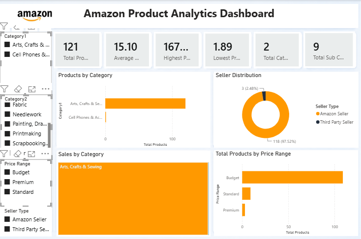

# 🛒 Amazon Product Analytics Dashboard

An interactive **Power BI** dashboard that analyzes Amazon.com product listings across categories, price ranges and seller types. It gives a quick view of what is being sold, at what price, and by whom.



---

## 📌 Table of Contents

- [Project Overview](#-project-overview)
- [Key Features](#-key-features)
- [Dataset](#-dataset)
- [Data Preparation (Power Query)](#-data-preparation-power-query)
- [Data Model & DAX](#-data-model--dax)
- [Dashboard Walkthrough](#-dashboard-walkthrough)
- [Key Insights](#-key-insights)
- [Tools & Technologies](#-tools--technologies)
- [How to Use](#-how-to-use)
- [Repository Structure](#-repository-structure)
- [Limitations & Future Improvements](#-limitations--future-improvements)
- [Author](#-author)

---

## 📖 Project Overview

The goal of this project is to turn raw Amazon product listing data into an easy-to-read, interactive dashboard. It answers questions such as:

- How many products are listed, and what do they cost on average?
- Which categories have the most products and the highest total listing value?
- How much of the catalog is sold by Amazon vs. third-party sellers?
- How are products spread across Budget, Standard, Premium and Luxury price bands?

---

## ✨ Key Features

- **6 KPI cards**: Total Products, Average Price, Highest Price, Lowest Price, Total Categories, Total Sub-Categories
- **4 interactive visuals**: bar charts, a donut chart and a treemap
- **4 slicers**: filter everything by Category, Sub-Category, Price Range and Seller Type
- **Custom Amazon-themed** colour palette and branded header
- **Cross-filtering**: click any visual to filter the rest of the page

---

## 📂 Dataset

| Property | Details |
|---|---|
| **Source file** | `marketing_sample_for_amazon_com-ecommerce__20200101_20200131__10k_data.csv` |
| **Description** | Sample of Amazon.com e-commerce product listings (January 2020) |
| **Raw size** | ~10,000 records, 28 columns |
| **After cleaning** | **9,617 rows**, 10 columns |

**Columns used in the final model**

| Column | Type | Description |
|---|---|---|
| `Uniq Id` | Text | Unique product identifier |
| `Product Name` | Text | Name of the product |
| `Category1` | Text | Top-level category |
| `Category2` | Text | Sub-category |
| `SellingPrice` | Decimal | Listing price in USD |
| `Shipping Weight` | Text | Shipping weight as listed |
| `Is Amazon Seller` | Text | `Y` = sold by Amazon, `N` = third-party |
| `Price Range` | Text *(calculated)* | Budget / Standard / Premium / Luxury |
| `Seller Type` | Text *(calculated)* | Amazon Seller / Third Party Seller |
| `Product Name Length` | Whole number *(calculated)* | Character count of the product name |

> The raw dataset is not included in this repository. Add a link to the original source here if you want others to reproduce the report.

---

## 🧹 Data Preparation (Power Query)

The following transformations were applied in Power Query:

1. Loaded the CSV file (UTF-8, 28 columns)
2. Removed 15 columns that were not needed for the analysis
3. Promoted the first row to headers and set data types
4. Removed the `$` symbol from `Selling Price` and converted it to a number
5. **Split `Category`** on the `|` delimiter into `Category1` (top level) and `Category2` (sub-category)
6. Removed rows where `Selling Price` could not be converted (errors)
7. Renamed columns for clarity and replaced null sub-categories with blanks
8. Dropped text-heavy columns (About Product, Product Specification, Technical Details, Image, Variants, Product Url, Product Dimensions) to keep the model light

---

## 🧮 Data Model & DAX

The model is a single table (`Amazon`) with the following DAX.

### Measures

```DAX
Total Products        = COUNT(Amazon[Uniq Id])
Average Price         = AVERAGE(Amazon[SellingPrice])
Highest Price         = MAX(Amazon[SellingPrice])
Lowest Price          = MIN(Amazon[SellingPrice])
Total Categories      = DISTINCTCOUNT(Amazon[Category1])
Total Sub Categories  = DISTINCTCOUNT(Amazon[Category2])
Total Sales           = SUM(Amazon[SellingPrice])

Amazon Seller Products =
CALCULATE(COUNTROWS(Amazon), Amazon[Is Amazon Seller] = "Y")

Third Party Products =
CALCULATE(COUNTROWS(Amazon), Amazon[Is Amazon Seller] = "N")
```

### Calculated Columns

```DAX
Price Range =
SWITCH(
    TRUE(),
    Amazon[SellingPrice] <= 25,  "Budget",
    Amazon[SellingPrice] <= 100, "Standard",
    Amazon[SellingPrice] <= 250, "Premium",
    "Luxury"
)

Seller Type =
IF(Amazon[Is Amazon Seller] = "Y", "Amazon Seller", "Third Party Seller")

Product Name Length = LEN(Amazon[Product Name])
```

**Price band definitions**

| Band | Price (USD) |
|---|---|
| Budget | ≤ $25 |
| Standard | $25 – $100 |
| Premium | $100 – $250 |
| Luxury | > $250 |

---

## 📊 Dashboard Walkthrough

The report has one main page, **Amazon Product Analytics Dashboard**.

| Section | Visual | What it shows |
|---|---|---|
| **KPI row** | 6 card visuals | Total Products, Average Price, Highest Price, Lowest Price, Total Categories, Total Sub-Categories |
| **Products by Category** | Clustered bar chart | Number of products in each top-level category |
| **Seller Distribution** | Donut chart | Share of products sold by Amazon vs. third-party sellers |
| **Sales by Category** | Treemap | Total listing value (sum of selling prices) by category |
| **Products by Price Range** | Clustered bar chart | Product count across Budget / Standard / Premium / Luxury |
| **Slicers (left panel)** | 4 slicers | Filter by Category, Sub-Category, Price Range, Seller Type |

### Headline numbers (unfiltered)

| KPI | Value |
|---|---|
| Total Products | **9,617** |
| Average Price | **$39.75** |
| Highest Price | **$5,332.00** |
| Lowest Price | **$0.01** |
| Total Categories | **24** |
| Total Sub-Categories | **104** |

---

## 💡 Key Insights

- **Toys & Games dominates the catalog**: about 68% of all products (6,549 of 9,617) and roughly 59% of the total listing value (about $223K of $378K).
- **Amazon is the main seller**: around 98% of listings (9,417) are sold by Amazon, versus only 200 (about 2%) by third-party sellers.
- **Most products are budget-friendly**: about 70% of products fall in the Budget band (≤ $25), with only about 2% (193 products) in the Luxury band.
- **Large price spread**: prices range from $0.01 to $5,332, while the average is only $39.75, so a small number of high-priced items pull the average up.
- **Home & Kitchen is the next largest category** (684 products), followed by Clothing, Shoes & Jewelry (512) and Sports & Outdoors (460). By listing value, Home & Kitchen (about $60K) and Sports & Outdoors (about $36K) come second and third.

---

## 🛠 Tools & Technologies

- **Power BI Desktop**: report design and visualization
- **Power Query (M)**: data cleaning and transformation
- **DAX**: measures and calculated columns
- **CSV**: source data format

---

## 🚀 How to Use

1. **Download** or clone this repository:
   ```bash
   git clone https://github.com/<your-username>/<your-repo-name>.git
   ```
2. **Open** `Manish_Power_Bi.pbix` in [Power BI Desktop](https://powerbi.microsoft.com/desktop/) (free to download, Windows only).
3. Use the **slicers** on the left and click on any chart to explore the data.
4. *(Optional)* To refresh with your own copy of the data, go to **Home → Transform data → Data source settings** and point the source to your local CSV file.

> ⚠️ The report was built from a local CSV path. If you see a data source error on opening, update the file path as described in step 4.

---

## 📁 Repository Structure

```
├── Manish_Power_Bi.pbix        # Power BI report file
├── README.md                   # Project documentation
└── images/
    └── dashboard-preview.png   # Dashboard screenshot
```

---

## ⚠️ Limitations & Future Improvements

**Current limitations**

- **"Total Sales" is not real sales revenue.** It is the sum of listing prices, because the dataset has no quantity sold or order data.
- About 795 products have no top-level category and show up as a blank group in the category visuals and slicers.
- The data covers a single month (January 2020), so no trend or time analysis is possible.

**Ideas for the future**

- Add a time dimension (multi-month data) for trend analysis
- Include ratings, reviews and sales-rank data
- Add a drill-through page for individual product details
- Build a second page with a deeper sub-category breakdown
- Publish to Power BI Service and embed a live link here

---

## 👤 Author

**[Your Name]**

- GitHub: [@your-username](https://github.com/your-username)
- LinkedIn: [your-profile](https://www.linkedin.com/in/your-profile)
- Email: your.email@example.com

---

⭐ If you found this project useful, consider giving the repository a star!
